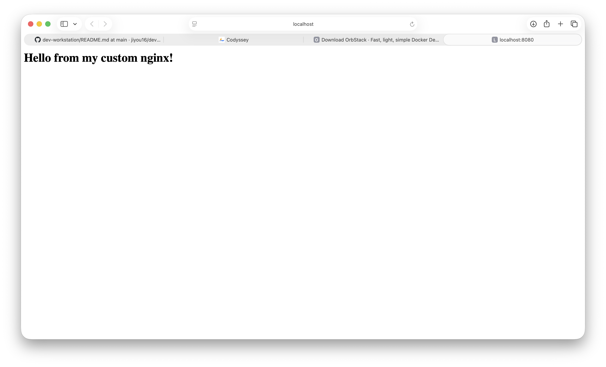
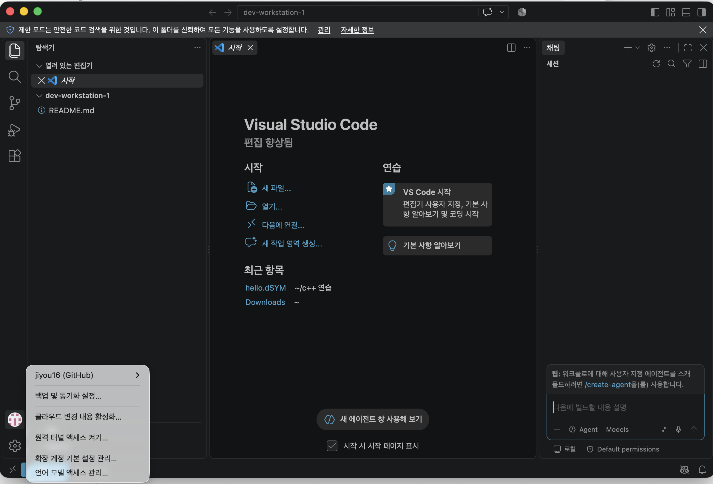
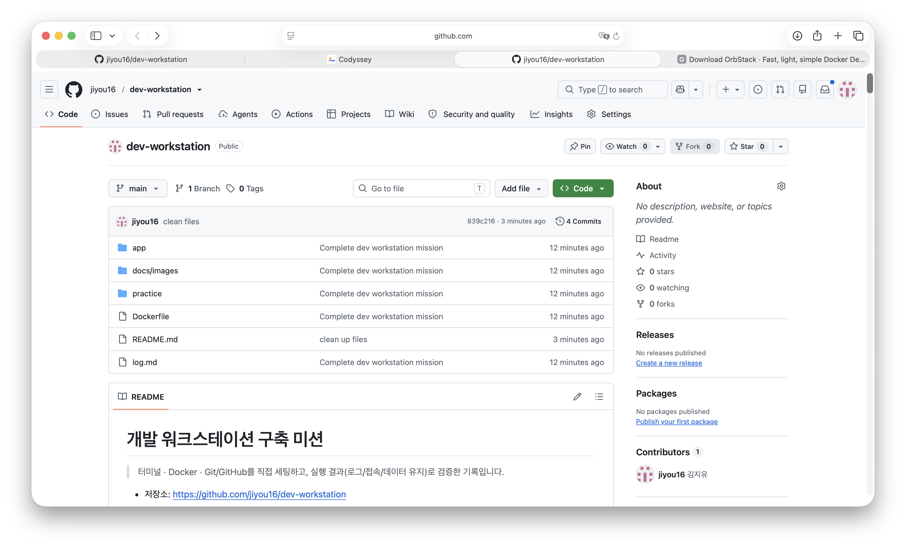

# 개발 워크스테이션 구축 미션

> 터미널 · Docker · Git/GitHub를 직접 세팅하고, 실행 결과(로그/접속/데이터 유지)로 검증한 기록입니다.

- 저장소: https://github.com/jiyou16/dev-workstation

---

## 1. 프로젝트 개요

이 미션의 목표는 "내 컴퓨터에서만 돌아가는" 문제를 줄이고, 누구나 같은 방식으로 실행할 수 있는 개발 환경을 직접 구성해 보는 것입니다.

- 터미널로 디렉토리/파일을 다루고 권한을 변경해 본다.
- Docker(OrbStack)를 점검하고 컨테이너를 실행·관리한다.
- NGINX 기반 커스텀 이미지를 Dockerfile로 만들고 포트 매핑으로 접속한다.
- 바인드 마운트로 "변경 반영", Docker 볼륨으로 "데이터 영속성"을 검증한다.
- Git 설정 후 VSCode와 GitHub를 연동해 결과물을 올린다.

---

## 2. 실행 환경

| 항목 | 내용 |
|---|---|
| OS | macOS 26.6.2 (Build 25G83), Apple Silicon (aarch64) |
| 쉘 | zsh (`/bin/zsh`) |
| 터미널 | VSCode 통합 터미널 |
| 컨테이너 런타임 | OrbStack (sudo 없이 Docker 엔진 실행) |
| Docker | 29.8.2 |
| Git | 2.54.0 (Apple Git-157) |

```bash
$ sw_vers
ProductName:		macOS
ProductVersion:		26.6.2
BuildVersion:		25G83

$ echo $SHELL
/bin/zsh

$ docker --version
Docker version 29.8.2, build 7fc2dff

$ git --version
git version 2.54.0 (Apple Git-157)
```

---

## 3. 수행 항목 체크리스트

- [x] 터미널 기본 조작 (위치 확인, 목록, 이동, 생성, 복사, 이름 변경, 삭제, 내용 확인, 빈 파일 생성)
- [x] 권한 변경 실습 (파일 1개, 디렉토리 1개)
- [x] Docker 설치 및 데몬 점검 (`docker --version`, `docker info`)
- [x] Docker 기본 운영 (images, ps, logs, stats)
- [x] hello-world / ubuntu 컨테이너 실행, attach vs exec 비교
- [x] Dockerfile 기반 커스텀 이미지 (NGINX)
- [x] 포트 매핑 접속 확인
- [x] 바인드 마운트 변경 반영 확인
- [x] Docker 볼륨 영속성 확인
- [x] Git 설정 및 GitHub/VSCode 연동

---

## 4. 검증 방법 요약

| 항목 | 사용한 명령 | 확인한 것 | 결과 위치 |
|---|---|---|---|
| 터미널 조작 | `pwd`, `ls -la`, `mkdir`, `cp`, `mv`, `rm` 등 | 파일/디렉토리가 의도대로 생성·변경·삭제됨 | [5장](#5-터미널-조작-로그) |
| 권한 | `ls -l`, `chmod` | 변경 전/후 권한 문자열 비교 | [6장](#6-권한-실습) |
| Docker 점검 | `docker --version`, `docker info` | 클라이언트·서버(데몬) 정보 출력 | [7장](#7-docker-설치-및-점검) |
| 컨테이너 운영 | `docker run`, `ps`, `logs`, `stats` | 실행/종료 상태, 로그, 리소스 | [8장](#8-docker-기본-운영-및-컨테이너-실습) |
| 커스텀 이미지 | `docker build`, `docker run -p` | 빌드 성공, 커스텀 페이지 응답 | [9장](#9-dockerfile-기반-커스텀-이미지) |
| 포트 매핑 | `curl localhost:8080`, 브라우저 | 호스트에서 컨테이너 웹 서버 접속 | [10장](#10-포트-매핑-접속-증거) |
| 바인드 마운트 | `-v $(pwd)/app:...` | 호스트 파일 수정이 즉시 반영 | [11장](#11-바인드-마운트-변경-반영) |
| 볼륨 | `docker volume create`, `-v mydata:/data` | 컨테이너 삭제 후에도 데이터 유지 | [12장](#12-docker-볼륨-영속성) |
| Git/GitHub | `git config --list`, VSCode 로그인 | 사용자 설정, 원격 저장소 연동 | [13장](#13-git-설정-및-github-연동) |

---

## 5. 터미널 조작 로그

작업 디렉토리 위치와 숨김 파일까지 포함한 목록을 확인했습니다.

```bash
$ pwd
/Users/kimjiyou/dev-workstation-1

$ ls -la
total 8
drwxr-xr-x@  6 kimjiyou  staff   192 Oct 29 14:04 .
drwxr-x---+ 46 kimjiyou  staff  1472 Oct 29 14:04 ..
drwxr-xr-x@ 12 kimjiyou  staff   384 Oct 29 14:04 .git
-rw-r--r--@  1 kimjiyou  staff    17 Oct 29 13:57 README.md
drwxr-xr-x@  2 kimjiyou  staff    64 Oct 29 14:04 app
drwxr-xr-x@  3 kimjiyou  staff    96 Oct 29 14:04 docs
```

`practice` 디렉토리를 만들고 그 안으로 이동해 생성·복사·이름 변경·이동·삭제를 수행했습니다.

```bash
$ mkdir practice
$ cd practice                 # 상대 경로로 이동
$ touch empty.txt             # 빈 파일 생성
$ echo "hello" > hello.txt    # 내용이 있는 파일 생성
$ cat hello.txt               # 파일 내용 확인
hello
$ cp hello.txt copy.txt       # 복사
$ mv copy.txt renamed.txt     # 이름 변경
$ mkdir sub
$ mv renamed.txt sub/         # 다른 디렉토리로 이동
$ ls -la sub
total 8
drwxr-xr-x@ 3 kimjiyou  staff   96 Oct 29 14:13 .
drwxr-xr-x@ 5 kimjiyou  staff  160 Oct 29 14:13 ..
-rw-r--r--@ 1 kimjiyou  staff    6 Oct 29 14:13 renamed.txt
$ rm sub/renamed.txt          # 파일 삭제
$ rmdir sub                   # 빈 디렉토리 삭제
$ ls -la
total 8
drwxr-xr-x@ 4 kimjiyou  staff  128 Oct 29 14:13 .
drwxr-xr-x@ 7 kimjiyou  staff  224 Oct 29 14:13 ..
-rw-r--r--@ 1 kimjiyou  staff    0 Oct 29 14:13 empty.txt
-rw-r--r--@ 1 kimjiyou  staff    6 Oct 29 14:13 hello.txt
```

### 절대 경로 vs 상대 경로

- **절대 경로**: 루트(`/`)부터 시작하는 전체 경로입니다. 현재 위치와 상관없이 항상 같은 곳을 가리킵니다.
  예: `/Users/kimjiyou/dev-workstation-1/practice`
- **상대 경로**: 현재 위치를 기준으로 하는 경로입니다.
  예: 작업 디렉토리에서 `cd practice`, 다시 상위로 갈 때 `cd ..`
- `pwd` 출력은 절대 경로이고, 위 실습의 `cd practice`, `mv renamed.txt sub/`는 상대 경로를 사용했습니다.

---

## 6. 권한 실습

### 파일: `practice/hello.txt` (644 → 600)

```bash
$ ls -l practice/hello.txt
-rw-r--r--@ 1 kimjiyou  staff  6 Oct 29 14:13 practice/hello.txt

$ chmod 600 practice/hello.txt

$ ls -l practice/hello.txt
-rw-------@ 1 kimjiyou  staff  6 Oct 29 14:13 practice/hello.txt
```

| | 변경 전 | 변경 후 |
|---|---|---|
| 표기 | `rw-r--r--` (644) | `rw-------` (600) |
| 의미 | 소유자 읽기/쓰기, 그룹·기타는 읽기 | 소유자만 읽기/쓰기, 나머지는 접근 불가 |

### 디렉토리: `practice` (755 → 700 → 755)

```bash
$ ls -ld practice
drwxr-xr-x@ 4 kimjiyou  staff  128 Oct 29 14:13 practice

$ chmod 700 practice

$ ls -ld practice
drwx------@ 4 kimjiyou  staff  128 Oct 29 14:13 practice

$ chmod 755 practice   # 원래대로 복구
```

| | 변경 전 | 변경 후 |
|---|---|---|
| 표기 | `rwxr-xr-x` (755) | `rwx------` (700) |
| 의미 | 누구나 목록 보기·진입 가능, 쓰기는 소유자만 | 소유자만 목록 보기·진입·쓰기 가능 |

### 권한 표기 해석 규칙

- `r`(읽기)=4, `w`(쓰기)=2, `x`(실행)=1을 더해 한 자리 숫자를 만듭니다.
- 세 자리는 순서대로 **소유자 / 그룹 / 기타 사용자**입니다.
  - `755` = 7(4+2+1, rwx) / 5(4+1, r-x) / 5(r-x)
  - `644` = 6(4+2, rw-) / 4(r--) / 4(r--)
- 디렉토리에서 `r`은 목록 보기, `w`는 파일 생성·삭제, `x`는 그 디렉토리로 진입(`cd`)할 수 있는 권한입니다.
- `ls -l` 맨 앞 글자가 `-`이면 파일, `d`이면 디렉토리입니다.

---

## 7. Docker 설치 및 점검

이 환경에서는 sudo를 쓸 수 없어서 OrbStack을 사용했습니다. OrbStack을 실행하면 내부에서 Docker 엔진이 함께 구동됩니다.

```bash
$ docker --version
Docker version 29.8.2, build 7fc2dff
```

`docker info`에서 **Server** 섹션이 출력되면 데몬이 정상 동작 중인 것입니다. (주요 부분만 발췌)

```bash
$ docker info
Client:
 Version:    29.8.2
 Context:    orbstack
 ...
Server:
 Containers: 0
  Running: 0
  Paused: 0
  Stopped: 0
 Images: 0
 Server Version: 29.8.2
 Storage Driver: overlayfs
 ...
 Kernel Version: 7.2.12-orbstack-00394-gbecdd6130068
 Operating System: OrbStack
 OSType: linux
 Architecture: aarch64
 CPUs: 15
 Total Memory: 11.73GiB
 ...
```

→ Context가 `orbstack`이고 Server 정보가 출력되므로, OrbStack의 Docker 데몬에 정상 연결된 것을 확인했습니다.

---

## 8. Docker 기본 운영 및 컨테이너 실습

### 8-1. hello-world

```bash
$ docker run hello-world
Unable to find image 'hello-world:latest' locally
latest: Pulling from library/hello-world
58dee6a49ef1: Pull complete
c3bdf82c34d1: Download complete
Digest: sha256:c567b231f65614688711a75f31518a064258a51d442117a3e771a3a8fdba78ef
Status: Downloaded newer image for hello-world:latest

Hello from Docker!
This message shows that your installation appears to be working correctly.

To generate this message, Docker took the following steps:
 1. The Docker client contacted the Docker daemon.
 2. The Docker daemon pulled the "hello-world" image from the Docker Hub.
    (arm64v8)
 3. The Docker daemon created a new container from that image which runs the
    executable that produces the output you are currently reading.
 4. The Docker daemon streamed that output to the Docker client, which sent it
    to your terminal.
...
```

→ 로컬에 이미지가 없어 Docker Hub에서 자동으로 pull한 뒤 실행되었습니다. Apple Silicon 환경이라 `arm64v8` 이미지를 받았습니다. (처음 실행할 때는 네트워크 오류로 실패했고, 재시도해서 성공했습니다. [트러블슈팅 ②](#-이미지-pull-실패-bad-gateway) 참고)

### 8-2. 이미지 목록

```bash
$ docker images
IMAGE                ID             DISK USAGE   CONTENT SIZE   EXTRA
hello-world:latest   c567b231f656       18.5kB         10.3kB    U
my-web:1.0           b772a40b8e6d       94.4MB         26.3MB    U
nginx:alpine         785835ea65db       95.3MB         27.2MB    U
ubuntu:latest        6a06111c3b0a        179MB         44.9MB
```

→ Docker Hub에서 받은 이미지(hello-world, nginx, ubuntu)와 직접 빌드한 커스텀 이미지(`my-web:1.0`)가 로컬에 저장된 것을 확인했습니다. `EXTRA`의 `U`는 현재 컨테이너가 사용(in Use) 중인 이미지라는 뜻입니다.

### 8-3. ubuntu 컨테이너 실행 후 내부 진입

```bash
$ docker run -it --name u1 ubuntu bash
root@f8bf472e7294:/# ls
bin  boot  dev  etc  home  lib  media  mnt  opt  proc  root  run  sbin  srv  sys  tmp  usr  var
root@f8bf472e7294:/# echo "hello from container"
hello from container
root@f8bf472e7294:/# exit
exit
```

→ 프롬프트가 `root@<컨테이너ID>`로 바뀌어 컨테이너 내부에 들어간 것을 확인했습니다. `ls` 결과는 맥이 아닌 리눅스(ubuntu) 파일 시스템입니다.

### 8-4. attach vs exec 비교

```bash
$ docker run -dit --name u2 ubuntu bash
c3ace4dde0cfa985d9fa8d647e6d9d9f4d0d01851b04b1d41644f7548d9831e6

# (1) exec로 진입 후 종료
$ docker exec -it u2 bash
root@c3ace4dde0cf:/# exit
exit
$ docker ps
CONTAINER ID   IMAGE     COMMAND   CREATED          STATUS          PORTS     NAMES
c3ace4dde0cf   ubuntu    "bash"    13 seconds ago   Up 13 seconds             u2

# (2) attach로 진입 후 종료
$ docker attach u2
root@c3ace4dde0cf:/# exit
exit
$ docker ps -a
CONTAINER ID   IMAGE     COMMAND   CREATED          STATUS                      PORTS     NAMES
c3ace4dde0cf   ubuntu    "bash"    23 seconds ago   Exited (0) 2 seconds ago              u2
f8bf472e7294   ubuntu    "bash"    50 seconds ago   Exited (0) 40 seconds ago             u1
```

| 방식 | 동작 | exit 후 컨테이너 상태 |
|---|---|---|
| `docker exec -it` | 컨테이너 안에 **새 프로세스(bash)**를 추가로 띄워 접속 | **Up** (유지됨): 종료된 건 추가로 띄운 bash뿐 |
| `docker attach` | 컨테이너의 **메인 프로세스(PID 1)**에 직접 연결 | **Exited** (종료됨): 메인 프로세스가 끝나면 컨테이너도 종료 |

- `docker run -it ... bash` 후 `exit`해도 컨테이너가 종료됩니다. bash가 메인 프로세스이기 때문입니다 (u1).
- attach 상태에서 컨테이너를 끄지 않고 빠져나오려면 `Ctrl+P` → `Ctrl+Q`를 사용합니다.

### 8-5. 로그 확인

```bash
$ docker logs u2
root@c3ace4dde0cf:/#
root@c3ace4dde0cf:/#
root@c3ace4dde0cf:/# exit
exit
```

→ attach로 접속했을 때 입력한 내용(메인 프로세스의 표준 출력)이 로그에 남은 것을 확인했습니다. (터미널 제어 문자는 가독성을 위해 제거했습니다.)

### 8-6. 리소스 확인

```bash
$ docker stats --no-stream
CONTAINER ID   NAME       CPU %     MEM USAGE / LIMIT     MEM %     NET I/O           BLOCK I/O     PIDS
28dbbd928bf9   web-bind   0.00%     10.06MiB / 11.73GiB   0.08%     2.22kB / 1.42kB   10.3MB / 0B   16
142c5b1d032c   web        0.00%     9.848MiB / 11.73GiB   0.08%     3.61kB / 1.81kB   1.19MB / 0B   16
```

→ 실행 중인 두 웹 서버 컨테이너의 CPU·메모리·네트워크·디스크 사용량을 확인했습니다. NGINX 컨테이너 하나가 메모리를 약 10MiB만 사용할 만큼 가볍습니다. (`--no-stream`은 실시간 갱신 없이 한 번만 출력하는 옵션입니다. 처음 실행했을 때는 실행 중인 컨테이너가 없어 빈 결과가 나왔습니다.)

---

## 9. Dockerfile 기반 커스텀 이미지

### 선택한 방식: (A) 웹 서버 베이스 이미지 활용

- **베이스 이미지**: `nginx:alpine` (공식 NGINX 이미지의 경량 Alpine Linux 버전)
- 기본 NGINX 환영 페이지 대신 직접 만든 정적 페이지를 보여 주도록 커스텀했습니다.

### 소스 코드: `app/index.html`

```html
<h1>Hello from my custom nginx!</h1>
```

### Dockerfile

```dockerfile
FROM nginx:alpine
LABEL maintainer="김지유"
COPY app/ /usr/share/nginx/html/
EXPOSE 80
```

### 커스텀 포인트와 목적

| 줄 | 목적 |
|---|---|
| `FROM nginx:alpine` | 검증된 웹 서버를 그대로 쓰고, 용량이 작은 alpine 버전으로 빌드·배포 속도 확보 |
| `LABEL maintainer=...` | 이미지 작성자 메타데이터 기록 (`docker inspect`로 확인 가능) |
| `COPY app/ /usr/share/nginx/html/` | NGINX 기본 문서 루트에 내 정적 콘텐츠를 넣어 **기본 페이지를 교체** |
| `EXPOSE 80` | 컨테이너가 80번 포트를 사용한다는 것을 문서화 |

### 빌드

```bash
$ docker build -t my-web:1.0 .
#0 building with "orbstack" instance using docker driver
#1 [internal] load build definition from Dockerfile
#1 transferring dockerfile: 127B done
#1 DONE 0.0s
#2 [internal] load metadata for docker.io/library/nginx:alpine
#2 DONE 2.0s
...
#5 [1/2] FROM docker.io/library/nginx:alpine@sha256:785835ea65db...
#5 DONE 2.4s
#6 [2/2] COPY app/ /usr/share/nginx/html/
#6 DONE 0.1s
#7 exporting to image
#7 naming to docker.io/library/my-web:1.0 done
#7 DONE 0.5s
```

→ `[1/2] FROM`(베이스 이미지)과 `[2/2] COPY`(커스텀 레이어) 두 단계로 빌드되어 `my-web:1.0` 이미지가 생성되었습니다.

### 실행

```bash
$ docker run -d --name web -p 8080:80 my-web:1.0
142c5b1d032c90cd2d419c47194127b1c3418b4bce0b8e51c62fb08294c578ed

$ docker ps
CONTAINER ID   IMAGE        COMMAND                  CREATED         STATUS         PORTS                                     NAMES
142c5b1d032c   my-web:1.0   "/docker-entrypoint.…"   4 seconds ago   Up 3 seconds   0.0.0.0:8080->80/tcp, [::]:8080->80/tcp   web
```

---

## 10. 포트 매핑 접속 증거

`-p 8080:80` 옵션으로 **호스트(맥)의 8080 포트**를 **컨테이너의 80 포트**에 연결했습니다.

```bash
$ curl localhost:8080
<h1>Hello from my custom nginx!</h1>
```

브라우저에서 `http://localhost:8080` 접속 화면:



### 포트 매핑이 필요한 이유

컨테이너는 호스트와 **격리된 네트워크**에서 실행됩니다. 컨테이너 안의 NGINX가 80번 포트를 열어도, 호스트나 외부에서는 그 포트에 바로 접근할 수 없습니다. `-p <호스트포트>:<컨테이너포트>`로 연결해 줘야 `localhost:8080`으로 들어온 요청이 컨테이너의 80번 포트로 전달됩니다. 또 호스트 포트만 바꾸면 같은 이미지를 여러 개 동시에 띄울 수도 있습니다 (예: 8080, 8081).

---

## 11. 바인드 마운트 변경 반영

호스트의 `app/` 디렉토리를 컨테이너의 NGINX 문서 루트에 **직접 연결**했습니다. 이미지를 다시 빌드하지 않고 호스트에서 파일을 수정해, 그 변경이 바로 반영되는지 확인했습니다.

```bash
$ docker run -d --name web-bind -p 8081:80 -v $(pwd)/app:/usr/share/nginx/html nginx:alpine
Unable to find image 'nginx:alpine' locally
alpine: Pulling from library/nginx
Digest: sha256:785835ea65db4bba6f021acc0f3be91b0fef76a53fe41f8588c6698d2aed0606
Status: Downloaded newer image for nginx:alpine
28dbbd928bf94d9ea2bec3252536640c46f28807e69dc58dadf4fdef0d1e72e9
```

**변경 전**
```bash
$ curl localhost:8081
<h1>Hello from my custom nginx!</h1>
```

**호스트에서 파일 수정**
```bash
$ echo "<h1>Changed on Mac!</h1>" > app/index.html
```

**변경 후** (컨테이너 재시작·재빌드 없음)
```bash
$ curl localhost:8081
<h1>Changed on Mac!</h1>
```

→ 호스트 파일을 수정하자 컨테이너 응답이 즉시 바뀌었습니다. 바인드 마운트는 호스트 경로를 그대로 공유하므로, 개발 중 코드 변경을 바로 확인할 때 유용합니다.

---

## 12. Docker 볼륨 영속성

### 생성

```bash
$ docker volume create mydata
mydata

$ docker volume ls
DRIVER    VOLUME NAME
local     mydata
```

### 연결 및 데이터 기록

```bash
$ docker run -d --name vol1 -v mydata:/data ubuntu sleep infinity
b50a45b9ead2209eca2538739b272d1a0758b9a8b71f3aee80c3a25f21fdf80a

$ docker exec vol1 sh -c "echo persist-me > /data/test.txt"

$ docker exec vol1 cat /data/test.txt     # 삭제 전
persist-me
```

### 컨테이너 삭제

```bash
$ docker rm -f vol1
vol1

$ docker ps -a                            # vol1이 목록에 없음
CONTAINER ID   IMAGE          COMMAND                  CREATED          STATUS          PORTS                                     NAMES
28dbbd928bf9   nginx:alpine   "/docker-entrypoint.…"   42 seconds ago   Up 42 seconds   0.0.0.0:8081->80/tcp, [::]:8081->80/tcp   web-bind
142c5b1d032c   my-web:1.0     "/docker-entrypoint.…"   3 minutes ago    Up 3 minutes    0.0.0.0:8080->80/tcp, [::]:8080->80/tcp   web
```

### 새 컨테이너에서 확인 (삭제 후)

```bash
$ docker run --rm -v mydata:/data ubuntu cat /data/test.txt
persist-me
```

→ 데이터를 쓴 컨테이너(`vol1`)를 삭제했지만, 같은 볼륨을 연결한 **새 컨테이너에서 데이터가 그대로 남아 있음**을 확인했습니다.

### Docker 볼륨이란

컨테이너 내부 파일 시스템은 컨테이너를 삭제하면 함께 사라집니다. **볼륨**은 Docker가 컨테이너 바깥에서 관리하는 저장 공간이라 컨테이너의 생명주기와 분리됩니다. 그래서 DB 데이터나 업로드 파일처럼 **유지되어야 하는 데이터**를 볼륨에 두면, 컨테이너를 지우거나 새 버전으로 교체해도 데이터가 보존됩니다.

| | 바인드 마운트 | 볼륨 |
|---|---|---|
| 저장 위치 | 내가 지정한 호스트 경로 | Docker가 관리하는 영역 |
| 주 용도 | 개발 중 소스코드 실시간 반영 | 영속 데이터 보관 (DB 등) |
| 생성 | 호스트 경로를 직접 지정 | `docker volume create` |

---

## 13. Git 설정 및 GitHub 연동

### Git 사용자 정보 및 기본 브랜치 설정

```bash
$ git config --global user.name "김지유"
$ git config --global user.email "xxx@xxx.com"
$ git config --global init.defaultBranch main
```

```bash
$ git config --list
credential.helper=osxkeychain
init.defaultbranch=main
user.name=김지유
user.email=xxx@xxx.com
core.repositoryformatversion=0
core.filemode=true
core.bare=false
core.logallrefupdates=true
core.ignorecase=true
core.precomposeunicode=true
remote.origin.url=https://github.com/jiyou16/dev-workstation.git
remote.origin.fetch=+refs/heads/*:refs/remotes/origin/*
branch.main.remote=origin
branch.main.merge=refs/heads/main
branch.main.vscode-merge-base=origin/main
```

> 개인정보 보호를 위해 이메일은 마스킹했습니다.

→ `remote.origin.url`이 GitHub 저장소를 가리키고, `main` 브랜치가 `origin/main`을 추적하도록 연동된 것을 확인했습니다.

### VSCode에서 GitHub 로그인

GitHub에서 저장소를 만든 뒤, VSCode의 **Git 리포지토리 복제 → GitHub에서 복제**로 로그인하고 저장소를 클론했습니다. 토큰을 직접 다루지 않고 브라우저 인증으로 연동했습니다.



### GitHub 저장소 연동 결과



### Git과 GitHub의 차이

| | Git | GitHub |
|---|---|---|
| 정체 | **버전 관리 도구** (프로그램) | Git 저장소를 호스팅하는 **원격 협업 플랫폼** (웹 서비스) |
| 동작 위치 | 내 컴퓨터(로컬) | 인터넷(원격 서버) |
| 하는 일 | 커밋, 브랜치, 변경 이력 관리 | 저장소 공유, PR, 이슈, 코드 리뷰 등 협업 |
| 인터넷 | 없어도 사용 가능 | 필요 |

Git만으로도 혼자 버전 관리는 할 수 있습니다. GitHub는 그 저장소를 원격에 올려 다른 사람과 공유·협업할 수 있게 해 줍니다.

---

## 14. 트러블슈팅

### ① `zsh: command not found: docker`

- **문제**: OrbStack을 설치·실행한 뒤 `docker --version`을 입력했는데 명령어를 찾지 못함.
- **원인 가설**: (1) OrbStack이 실행되지 않았거나, (2) sudo 없이 설치되어 docker CLI가 시스템 경로(`/usr/local/bin`)가 아닌 사용자 경로에 있고, 그 경로가 `PATH`에 등록되지 않음.
- **확인**: `ls ~/.orbstack/bin`으로 `docker` 실행 파일이 있는 것을 확인 → 설치는 됐지만 PATH 문제로 판단.
- **해결**: PATH에 경로를 추가하고 쉘 설정 파일에 영구 등록.
  ```bash
  echo 'export PATH="$HOME/.orbstack/bin:$PATH"' >> ~/.zprofile
  source ~/.zprofile
  docker --version
  # Docker version 29.8.2, build 7fc2dff
  ```

### ② 이미지 pull 실패: `Bad Gateway`

- **문제**: `docker run hello-world`와 `docker pull ubuntu`가 실패함.
  ```
  docker: Error response from daemon: failed to resolve reference "docker.io/library/hello-world:latest":
  failed to do request: Head "https://registry-1.docker.io/v2/library/hello-world/manifests/latest": Bad Gateway
  ```
- **원인 가설**: 로컬에 이미지가 없어 Docker Hub에서 받아야 하는데, 레지스트리까지 가는 네트워크 경로(캠퍼스 네트워크 또는 OrbStack 프록시 `proxy.orb.internal`)에서 일시적인 오류가 발생함.
- **확인**: `docker info`로 데몬은 정상인 것을 확인했고, `docker images`가 비어 있어 pull 단계에서 실패한 것을 확인. 잠시 뒤 `docker run -it ubuntu`는 정상적으로 이미지를 받아 실행됨 → 설정 문제가 아니라 일시적인 네트워크 문제로 판단.
- **해결**: 잠시 후 재시도하여 정상적으로 pull 및 실행 ([8-1](#8-1-hello-world) 참고).

### ③ 컨테이너 이름 충돌

- **문제**: attach/exec 실습을 다시 하려고 `docker run -dit --name u2 ubuntu bash`를 실행했더니 에러 발생.
  ```
  docker: Error response from daemon: Conflict. The container name "/u2" is already in use by container "0843876c8364...".
  You have to remove (or rename) that container to be able to reuse that name.
  ```
- **원인 가설**: 이전에 만든 `u2` 컨테이너가 종료(Exited) 상태로 남아 있어 이름이 중복됨. 컨테이너는 종료돼도 삭제하기 전까지 남아 있음.
- **확인**: `docker ps -a`로 기존 `u2`가 남아 있는 것을 확인.
- **해결**: 기존 컨테이너를 삭제하고 다시 실행.
  ```bash
  docker rm -f u2
  docker run -dit --name u2 ubuntu bash
  ```
  자동으로 지워지게 하려면 `docker run --rm` 옵션을 쓰면 됩니다.

### ④ `zsh: event not found: </h1>`

- **문제**: `echo "<h1>Hello from my custom nginx!</h1>" > app/index.html` 실행 시 에러 발생.
- **원인 가설**: zsh는 큰따옴표 안의 `!`를 **히스토리 확장**(이전 명령 불러오기) 기호로 해석함. `!</h1>`를 이전 명령으로 찾으려다 실패함.
- **확인**: `!`가 없는 문자열은 정상 동작하는 것을 확인.
- **해결**: 작은따옴표로 감싸서 `!`를 일반 문자로 처리.
  ```bash
  echo '<h1>Hello from my custom nginx!</h1>' > app/index.html
  ```

---

## 15. 디렉토리 구조

```
dev-workstation/
├── README.md          # 기술 문서 (본 문서)
├── Dockerfile         # 커스텀 NGINX 이미지 정의
├── app/
│   └── index.html     # 웹 서버 정적 콘텐츠
├── docs/
│   └── images/        # 증거 스크린샷
│       ├── port.png
│       ├── vscode-login.png
│       └── github-repo.png
└── practice/          # 터미널·권한 실습 파일
```

---

## 16. 보안 및 개인정보

- 문서·로그·스크린샷에 비밀번호, 토큰, 개인키, 인증 코드는 포함하지 않았습니다.
- `git config --list`의 이메일은 마스킹했습니다.
- GitHub 인증은 VSCode의 브라우저 로그인과 macOS 키체인(`credential.helper=osxkeychain`)을 사용해, 토큰을 직접 입력하거나 파일에 저장하지 않았습니다.